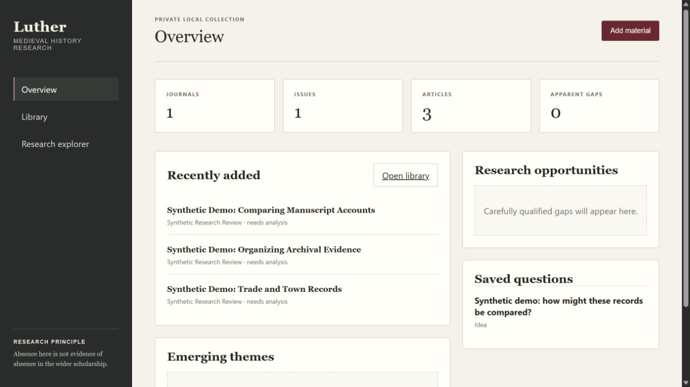
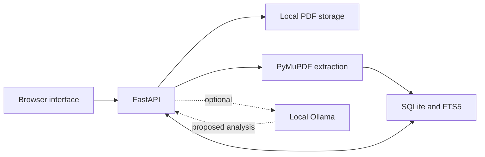

<p align="center"></p>

[Regan Yates](https://github.com/rjyates) · [Homelab](https://github.com/rjyates/homelab)


# Research context, kept close to its sources

Luther is a personal research tool built around a medieval-history workflow. It organizes journal articles, extracts text from uploaded PDFs, and provides a searchable local collection. Optional Ollama analysis adds summaries, classifications, and carefully labeled research opportunities.

The central design principle: **an omission in one article is not evidence of a gap in the wider literature**. Generated suggestions are starting points for a researcher's review, not verified scholarly findings.

**Status:** implemented local prototype. The non-AI workflow was verified with synthetic material on October 22, 2026. Model quality, scholarly accuracy, and production security are not certified.

## See the workflow



*All visible records are fictional demonstration material. No model inference was run for these screenshots; articles correctly remain “needs analysis.”*

[Library view](docs/images/library-synthetic.png) · [Search results](docs/images/search-synthetic.png) · [Architecture & case study](docs/architecture.md) · [Verification](docs/verification.md)

## Implemented capabilities

- **Journal → Volume → Issue → Article** organization.
- PDF and ZIP ingestion, text extraction, basic metadata heuristics, and local PDF access.
- SQLite full-text search, with theme/geography filters once classifications exist.
- Optional local Ollama summaries, keywords, classifications, and research-opportunity labels.
- Separation of author-identified gaps, article limitations, and potential AI-inferred gaps.
- Research-question storage and a browser interface for the library and article views.

## Quick start — Windows

Install Python **3.12** with the Python launcher, then run from the repository root:

```powershell
.\install.ps1
.\start.ps1
```

The installer creates `.venv` and installs the pinned dependencies in [requirements.txt](requirements.txt). The launcher binds the app to **127.0.0.1:8000**. Open that address in your browser; stop the console with Ctrl+C.

For optional analysis, install Ollama, make a compatible model available, and keep Ollama running. The current UI defaults to `qwen3:8b`; PDF ingestion and search work without it. Model downloads and inference need additional disk, memory, and compute capacity.

## First use

1. Create a journal, then add a volume/issue.
2. Upload a PDF, multiple PDFs, or a ZIP containing PDFs you are authorized to use.
3. Leave local analysis unchecked to begin with extraction only.
4. Browse the library or search the extracted text.
5. If using Ollama, review generated analysis against the original PDF.

## Architecture



The application uses a small local service and database rather than a distributed stack. [Read the design decisions and limitations →](docs/architecture.md)

## Source map

| File | Responsibility |
| :--- | :--- |
| [luther/main.py](luther/main.py) | API, ingestion, search, and static UI delivery |
| [luther/analyzer.py](luther/analyzer.py) | PDF extraction, metadata heuristics, and optional model request |
| [luther/schema.sql](luther/schema.sql) | Relational data model, FTS5 index, and triggers |
| [luther/db.py](luther/db.py) | SQLite connections and transaction handling |
| [static/](static/) | Browser UI and styling |

## Data, privacy, and recovery

Runtime records live in `data/luther.db`; uploaded PDFs live in `data/uploads/`. These paths are excluded from Git. **Public source code does not make a user's research collection public.** Git exclusions are not encryption or access controls.

The supplied launcher is intended for trusted local use. The current app has no user-authentication layer; do not treat it as an internet-ready service. The model request sends extracted article text to the configured local Ollama endpoint, not a hosted AI API.

Stop Luther before making a private copy of the complete `data/` directory. Copying source alone does not back up the collection. Test recovery separately before relying on a backup.

## Known limits and future work

- Metadata extraction is heuristic; scanned/image-only PDFs do not gain OCR from the current extractor.
- Model requests use a bounded text excerpt; results can omit material or be incorrect.
- Prompts ask for evidence and cautious language, but do not guarantee factual grounding or correct citations.
- No production multi-user authentication, automated backup policy, or scholarly validation is claimed.
- More robust model-output validation, ingestion limits, repeatable regression tests, and recovery testing are useful next steps, not completed features.
